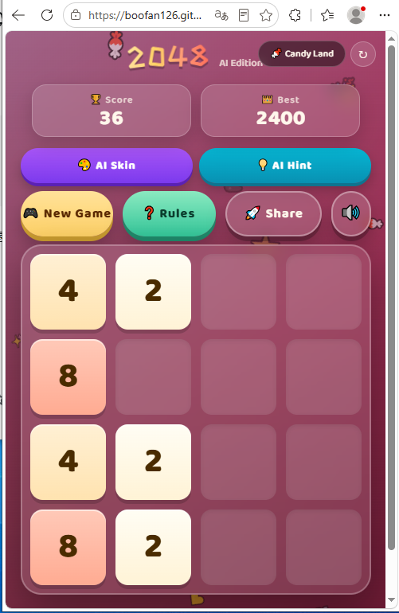
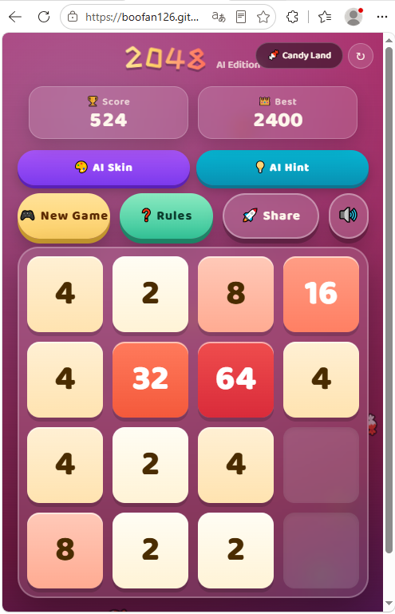
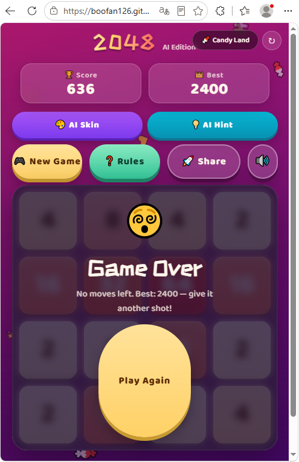

# 2048 AI Edition

A single-file 2048 game with AI-powered features via Pollinations API.

## Features

- Classic 2048 gameplay (4×4 grid, swipe/keyboard, win/lose detection)
- **AI Skin** — Generate custom game themes using Pollinations `flux-2-dev-free` image model
- **AI Hint** — Get strategic advice from Pollinations `qwen3.7-flash` text model
- Candy-themed default skin with 8 preset AI themes
- Glassmorphism UI, floating emojis, confetti celebration
- Web Audio API sound effects + haptic feedback
- LocalStorage high score, share button, feedback toggle
- Mobile + desktop, zero dependencies, offline playable

## Tech

- Pure HTML/CSS/JS, single file
- Pollinations API (no key needed):
  - Images: `https://image.pollinations.ai/prompt/{prompt}?model=community/scriptsnsenses-sys/flux-2-dev-free`
  - Text: `https://text.pollinations.ai/openai?model=community/YoannDev90/qwen3.7-flash&prompt={prompt}`

## Screenshots

| Early game | Advanced game | Game Over |
|------------|--------------|-----------|
|  |  |  |

Direct links:
- https://raw.githubusercontent.com/boofan126/mini2048-ai/main/screenshots/screenshot-gameplay-early.png
- https://raw.githubusercontent.com/boofan126/mini2048-ai/main/screenshots/screenshot-gameplay-advanced.png
- https://raw.githubusercontent.com/boofan126/mini2048-ai/main/screenshots/screenshot-gameover.png

Release assets (github.com hosted, same images):
- https://github.com/boofan126/mini2048-ai/releases/download/screenshots/screenshot-gameplay-early.png
- https://github.com/boofan126/mini2048-ai/releases/download/screenshots/screenshot-gameplay-advanced.png
- https://github.com/boofan126/mini2048-ai/releases/download/screenshots/screenshot-gameover.png
- Release page: https://github.com/boofan126/mini2048-ai/releases/tag/screenshots

## License

Based on [gabrielecirulli/2048](https://github.com/gabrielecirulli/2048) (MIT).